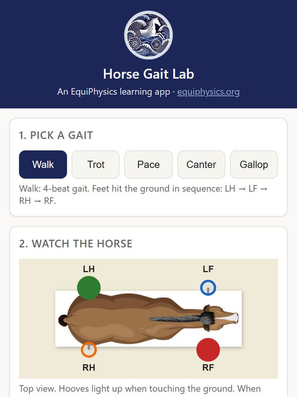
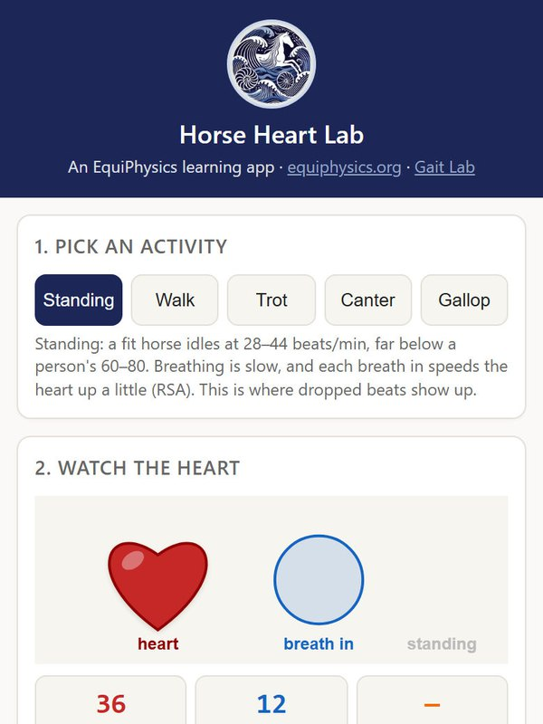

# EquiPhysics web apps

Free browser apps for classrooms, from [EquiPhysics](https://www.equiphysics.org), a nonprofit in Sonoita, Arizona. They run on any phone, tablet, or laptop. There is nothing to install and no sign-in, and they send us nothing.

<table>
<tr>
<td width="50%" valign="top"></td>
<td width="50%" valign="top"></td>
</tr>
<tr>
<td valign="top"><b><a href="https://equiphysics.github.io/web-apps/">Horse Gait Lab</a></b> Pick a gait and watch the hooves light up. See the footfall pattern, listen to the hoofbeats, try the math behind it, and compare the model with 80 real strides from a sensor session.</td>
<td valign="top"><b><a href="https://equiphysics.github.io/web-apps/heart/">Horse Heart Lab</a></b> A horse heartbeat from standing still to a gallop. Read the ECG, watch breathing change the heart rate, try the math behind it, and compare the model with Duque's own heartbeats.</td>
</tr>
</table>

## Lessons for each app

Worksheets, teacher guides, answer keys, and slides are in [equiphysics/education](https://github.com/equiphysics/education):

- Horse Gait Lab: [`labs/Outreach-HorseGaits`](https://github.com/equiphysics/education/tree/main/labs/Outreach-HorseGaits)
- Horse Heart Lab: [`labs/Horse-Heart-Lab`](https://github.com/equiphysics/education/tree/main/labs/Horse-Heart-Lab)

The QR codes on the worksheets point to https://equiphysics.github.io/web-apps/, so that address will stay the same.

Did you use an app in class? Please [tell us how it went](https://www.equiphysics.org/for-teachers#tell-us)!

## Help keep these apps free

Can't give right now? You can still help a lot. Share the apps with another teacher, star this repository, and follow us on [Instagram](https://www.instagram.com/equiphysics_institute/), [Facebook](https://www.facebook.com/profile.php?id=61579151426160), [LinkedIn](https://www.linkedin.com/company/equiphysics-institute/), and [GitHub](https://github.com/equiphysics). Follows and shares help us show grant funders that people value this work. If you can give, you can [donate to EquiPhysics](https://www.equiphysics.org/donate).

## License

MIT License. See [LICENSE](LICENSE). Please credit EquiPhysics if you adapt the apps.
